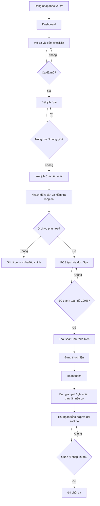
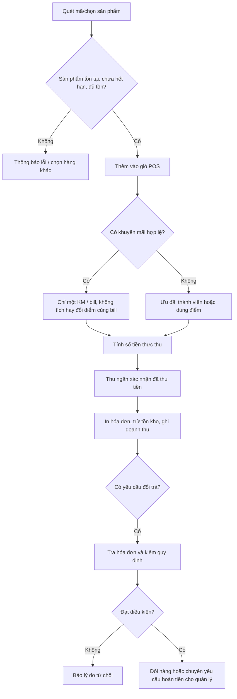

# TiTi Pet — Hướng dẫn dựng Figma từ HTML prototype

**Tài liệu đối chiếu:** `TITIPET.pdf` (bản thiết kế giao diện có sẵn) và `Nhom06_REPORT_ApplicationDevelopment[v4].docx` (báo cáo phân tích nghiệp vụ nhóm 06).

## 1. Mục tiêu và giới hạn

`TiTiPet_Figma_Prototype.html` là **một file HTML tự chứa** (HTML, CSS, JavaScript cùng một file), mô phỏng hệ thống **nội bộ cửa hàng**. Có thể mở bằng Chrome / Edge, đăng nhập nhanh theo vai trò, click menu, nhập biểu mẫu, đổi trạng thái và thao tác dữ liệu giả lập.

Đây là **UX prototype phía trình duyệt**, không phải ứng dụng sản xuất: không có SQL Server, API, đăng nhập bảo mật thật, phân quyền ở máy chủ, sao kê ngân hàng tự động hay kết nối máy in/máy quét vật lý. Dữ liệu demo được lưu thử bằng `localStorage` nếu trình duyệt cho phép; mở ở chế độ ẩn danh / nguồn khác có thể không giữ dữ liệu.

Phạm vi loại trừ theo báo cáo: ứng dụng tự đặt lịch cho khách, cổng thanh toán online (chỉ QR tĩnh/đối soát thủ công), giao nhận đơn, chấm công và tính lương.

## 2. Hướng dẫn mở và thao tác

1. Tải và nhấp đúp `TiTiPet_Figma_Prototype.html` hoặc mở file trong Chrome / Edge.
2. Trang đầu có vai trò **Lễ tân / Thu ngân**, **Thợ Spa**, **Quản lý**. Nhấn các nút trải nghiệm nhanh để chuyển vai trò, không cần máy chủ.
3. Lễ tân: vào **Mở / chốt ca**, đánh dấu 4 thiết bị, mở ca. Sau đó vào **Đặt lịch** → **Tiếp nhận** → **POS**, thu 100% tiền Spa, mới được chuyển thú cưng sang **Điều phối Spa**.
4. Thợ Spa: đăng xuất/đổi vai trò, đăng nhập **Thợ Spa**, vào **Điều phối Spa** để chuyển tiến độ và bàn giao.
5. Quản lý: đăng nhập **Quản lý** để xem **Kho / danh mục / Khuyến mãi / Thống kê**, phê duyệt phiếu chốt ca.
6. Với Figma, mở lần lượt các màn hình và chụp khung 1440 × 900 hoặc 1536 × 960. Có thể sử dụng một plugin bên thứ ba hỗ trợ nhập HTML/website vào Figma; kiểm tra lại độ chính xác của layer, font và Auto Layout sau khi nhập.

## 3. Bộ màn hình cần tạo trong Figma

| Frame | Màn hình | Tác nhân | Thành phần chính và trạng thái cần thiết |
|---|---|---|---|
| 01 | Đăng nhập | 3 vai trò | Form, thiếu tên/mật khẩu, thành công, role switch |
| 02 | Dashboard | 3 vai trò | KPI, lịch hôm nay, cảnh báo, thao tác nhanh |
| 03 | Mở ca | Thu ngân, quản lý | Checklist 4 thiết bị, quỹ đầu ca, lỗi thiếu checkbox, mở thành công |
| 04 | Đặt lịch Spa | Thu ngân | Form lịch, thợ/giờ, trùng thợ, không hợp lệ, tạo/dời/hủy |
| 05 | Tiếp nhận thú cưng | Thu ngân | Phiếu khách/pet, cân nặng, lông/da, giá demo, từ chối, chuyển POS |
| 06 | POS | Thu ngân | Tìm/quét mã giả lập, danh mục, giỏ, số lượng, VIP, KM, điểm, xác nhận thu |
| 07 | Chi tiết hóa đơn | Thu ngân | Sản phẩm/dịch vụ, giảm giá, kênh, trạng thái, in/PDF |
| 08 | Điều phối Spa | Thợ Spa, quản lý | Kanban chờ/đang làm/hoàn thành/bàn giao, vật tư, phí thức ăn |
| 09 | Đổi trả | Thu ngân | Tra cứu hóa đơn, check điều kiện, đổi ngang giá/trả, lý do từ chối |
| 10 | Khách hàng/VIP | Thu ngân, quản lý | List, thêm/sửa, số điện thoại duy nhất, điểm, thẻ VIP |
| 11 | Thú cưng | Thu ngân, quản lý | List/card, thêm/sửa, liên kết chủ, cân nặng/lưu ý |
| 12 | Kho & nhập hàng | Quản lý | Nhập hàng, tồn, HSD, hàng cận hạn/hết hạn, cảnh báo |
| 13 | Danh mục & bảng giá | Quản lý | Tạo/sửa sản phẩm và dịch vụ, loại loài, cân nặng |
| 14 | Khuyến mãi | Quản lý | Tạo, sửa, tắt/bật, một chương trình/bill, ngày hiệu lực |
| 15 | Chốt ca/đối soát | Thu ngân, quản lý | Quỹ kỳ vọng/thực, lệch, phiếu chờ duyệt, duyệt/từ chối/sửa |
| 16 | Báo cáo | Quản lý | KPI, biểu đồ 7 ngày, nguồn Shopee/TikTok/quầy, CSV |
| 17 | Tra cứu giao dịch | Thu ngân, quản lý | Tìm mã hóa đơn, khách hàng, trạng thái, in |
| 18 | UX Flow & Design System | Tất cả | Ma trận 19 UseCase, 6 luồng nghiệp vụ, 15 trạng thái giao diện |

**Overlay/components nên tách:** modal Thêm khách, Thêm pet, Nhập kho, Tạo KM, Đổi lịch, Từ chối Spa, Ghi vật tư, Bàn giao, Phiếu hóa đơn; toast thành công/lỗi; badge trạng thái; form field; nút primary/secondary/danger; thẻ KPI; bảng dữ liệu; sidebar.

## 4. Các luồng hành động chính

## 5. Nghiệp vụ và ngoại lệ cần thể hiện khi nối Prototype Links

- **UC001/005 (Pet & Khách hàng):** thêm/sửa hồ sơ, liên kết chủ nuôi, tra cứu qua SĐT/tên, xác thực SĐT đủ 10 số và không trùng.
- **UC002 (Đổi trả):** hàng không hỗ trợ đổi gồm tã/bỉm, vệ sinh pet, thức ăn, thuốc, hàng hỗ trợ chuồng; tối đa một lần; liên hệ sau 12:00; sạch, không lông/mùi, chưa dùng; hàng thay giá không thấp hơn hàng cũ, không hoàn tiền thừa. Phiếu bán lẻ mẫu ghi đổi trong 24 giờ.
- **UC003 (Đặt lịch):** kiểm trùng theo thời gian bắt đầu + thời lượng của **cùng một thợ**; lưu Chờ tiếp nhận; dời/hủy phải báo trước ít nhất 1,5 giờ theo bảng khảo sát; lịch Fanpage/TikTok chỉ là lịch chờ, không coi đã thanh toán.
- **UC004 (Tiếp nhận):** kiểm pet thật tại quầy, xác nhận loài/cân nặng/tình trạng, từ chối/điều chỉnh và nhập lý do thực tế; **tiền Spa phải thanh toán 100% trước khi thợ làm**.
- **UC006/007 (Ca):** checklist → nhập quỹ → thu giao dịch → đối soát tiền mặt, QR/chuyển khoản → phiếu chờ quản lý xác nhận; nếu lệch thì ghi nguyên nhân, quản lý có thể từ chối để thu ngân kiểm tra lại.
- **UC008/019 (POS/Tích điểm):** kiểm tồn kho và HSD trước bán; thành tiền = đơn giá × số lượng; mỗi 50.000đ chi tiêu được 1 điểm; 1 điểm = 1.000đ. Không dùng điểm vượt số hiện có, không tích thêm điểm cho bill đã đổi điểm theo đặc tả.
- **UC009 (KM):** tối đa một chương trình hóa đơn; kiểm ngày, mặt hàng đủ điều kiện; nếu cần dùng điểm đồng thời thì **tách hóa đơn**.
- **UC010/011 (Báo cáo/Tra cứu):** tìm mã bill/SĐT/khách/pet/hàng/lịch, thống kê theo ca/ngày/kênh, xuất CSV.
- **UC012/017/018 (Thợ Spa):** xem ca được phân công, chuyển chờ → đang làm → hoàn thành, ghi vật tư, bàn giao, phát sinh thức ăn khi khách đến trễ; **không có phí lưu chuồng**.
- **UC013/014/016 (Danh mục/kho):** quản lý thêm/sửa danh mục, nhập hàng và theo dõi hạn sử dụng, cảnh báo tồn và cận date; hóa đơn thanh toán trừ kho.
- **UC015 (Đăng nhập):** 3 vai trò, phân quyền ở màn hình và hành động; trong ứng dụng thật phải có xác thực, phân quyền API/máy chủ và transaction database.

## 6. Những điểm cần xác nhận trước khi chuyển thành sản phẩm thật

1. **Bảng giá đầy đủ theo loài và cân nặng**, ngưỡng cận hạn/tồn thấp: bản HTML sử dụng giá và ngưỡng minh họa để chạy luồng; không xác nhận là giá cửa hàng.
2. **Ngưỡng doanh số lên hạng VIP:** nguồn chỉ xác nhận các mức giảm Bạc/Vàng/Kim cương 3%/4%/5% và xét tổng chi tiêu một năm, chưa đủ dữ liệu về giá trị ngưỡng. Giao diện cho quản lý gán hạng trực tiếp.
3. **Chính sách hoàn tiền:** đặc tả Use Case có bước trả tiền, nhưng quy định thu thập mới nêu chi tiết điều kiện đổi sản phẩm. Giao diện đưa yêu cầu trả về trạng thái cần quản lý duyệt, để tránh tự xác định chính sách chưa có căn cứ.
4. **Xác nhận chốt ca:** một phần khảo sát nói chỉ quản lý có quyền kết sổ/xem doanh thu, còn đặc tả chức năng cho lễ tân lập phiếu rồi quản lý xác nhận. Prototype tách 2 bước: lễ tân đối soát, quản lý duyệt cuối.
5. **Quản lý HSD theo lô:** demo chỉ lưu một HSD/sản phẩm; triển khai thật nên quản lý từng lô, mã lô và FIFO/FEFO.
6. **Chi phí thức ăn / hoàn tiền:** cần quy tắc kế toán, cách tính điểm/tồn kho hoàn trả, tính quỹ mặt, quyền duyệt và ghi nhận hóa đơn điều chỉnh trong hệ thống thật.

## 7. Design tokens cho Figma

| Token | Giá trị |
|---|---|
| Primary / Accent | `#245FB5` / `#397CE7` |
| Sidebar | `#153B76` |
| Success / Warning / Danger | `#14AD98` / `#F3A33A` / `#E76370` |
| Background / Card | `#F5F8FD` / `#FFFFFF` |
| Ink / Secondary text | `#202D47` / `#8190A9` |
| Stroke | `#E8EDF5` |
| Font | Inter (fallback Segoe UI, Arial) |
| Content grid gap / radius card | 18px / 17px |
| Input radius / topbar / sidebar | 10px / 75px / 248px |
| Desktop frame đề xuất | 1440 × 900 (responsive ở 1024/768) |

Tạo 3 biến thể component quan trọng: **Default / Hover / Disabled** cho nút, **Default / Focus / Error** cho input, và **Pending / Processing / Paid / Done / Rejected** cho badge. Khi nối Prototype interactions, dùng Navigate to, Open overlay, Change to variant và Smart Animate tùy loại tương tác.

---

*Lưu ý:* HTML tạo giao diện và hành vi tương tác; nó **không phải file `.fig` hoặc dự án Figma chỉnh sửa trực tiếp**. Việc chuyển thành layer native/Auto Layout cần thực hiện trong Figma hoặc bằng công cụ nhập HTML của bên thứ ba.
